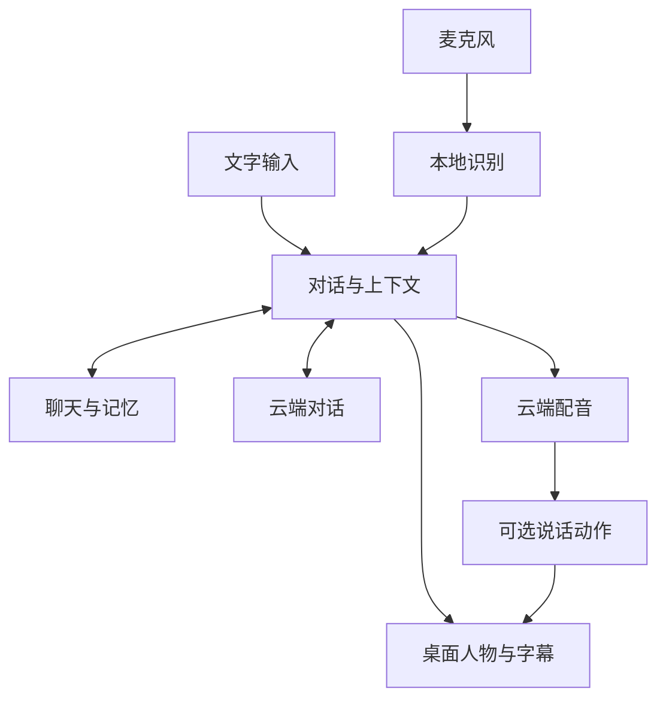

<h1 align="center">AI伴侣</h1>

<strong>桌面里，多一个陪你说话的人。</strong>

<a href="README.md">简体中文</a> · <a href="docs/i18n/README.zh-TW.md">繁體中文</a> · <a href="docs/i18n/README.en.md">English</a> · <a href="docs/i18n/README.ja.md">日本語</a>

   

 <a href="docs/SETUP.zh-CN.md">图文配置教程</a> · <a href="https://github.com/ycwdjb599-hub/ai-companion-desktop/releases/latest">版本与更新</a> · <a href="https://github.com/ycwdjb599-hub/ai-companion-desktop/issues/new/choose">反馈问题</a>

<a href="#companion">人物与功能</a> · <a href="#technology">技术栈</a> · <a href="#start">快速开始</a> · <a href="#requirements">使用要求</a>

一个生活在 Windows 桌面上的 AI 小伙伴。她可以陪你聊今天、听你说话，也会把聊天记录与记忆留在你的电脑里。

## 让陪伴留在桌面上

<table>
<tr>
<td align="center" width="36%"> Model 2 · 当前默认人物</td>
<td width="64%">

<strong>桌面陪伴</strong> 拖动、任务栏与窗口边缘坐姿，待机动作与表情。

<strong>文字与语音</strong> 文字聊天、按住说话、连续语音；可以用按钮打断回复。

<strong>交流有延续</strong> 本机保存聊天记录与记忆，随时打开历史记录回看。

<strong>按自己的习惯</strong> 可拖动的字幕、逐句或滚动显示；调整字体、颜色、大小、帧率和画质。

</td>
</tr>
</table>

## 背后的技术

云端负责对话与配音，本机负责识别、人物呈现与数据保存。动作模块独立准备，下载失败时仍可先使用基础聊天。

| 模块 | 当前技术 | 作用 |
| --- | --- | --- |
| 桌面界面 | **C# · .NET 10 · WinForms** | Windows 界面与会话编排 |
| 人物渲染 | **Unity · UniVRM** | 透明桌面人物、VRM、表情与动画 |
| AI 对话 | **Qwen Character API** | 推荐的对话服务；使用自己的 API Key |
| 语音识别 | **SenseVoiceSmall INT8 · sherpa-onnx · Silero VAD** | 本地语音识别与说话检测 |
| 声音生成 | **Qwen TTS API** | 云端配音；本地声音模型为可选项 |
| 本地记忆 | **SQLite · Qwen3 Embedding 0.6B** | 聊天与状态保存、本地历史语义检索 |
| 说话动作 | **StreamTalk · WavLM · Fixed Body** | 可选的语音驱动动作与人物骨架适配 |
| 安装分发 | **Velopack · GitHub Releases · SHA-256** | 安装、资源续传、完整性校验与版本分发 |

查看输入、对话、记忆与动作的连接方式

## 三步，开始第一次聊天

1. **安装** — 下载并运行上方的 Windows 安装程序。无需手工安装 Unity 编辑器、Python 或 Conda。
2. **连接** — 首次打开选择资源盘，点「准备并继续」；资源自动下载。按图文教程填写自己的千问 Character Key 与业务空间 ID，再点「检查并继续」。
3. **开始陪伴** — 准备完成后点「开始陪伴」。右键人物打开设置，其余外观与声音选项可以以后慢慢调整。

[图文配置教程](docs/SETUP.zh-CN.md)

| 操作 | 默认方式 |
| --- | --- |
| 打开设置 | 右键人物 |
| 按住说话 | Right Ctrl |
| 连续语音开关 | Ctrl + Alt + V |
| 停止播放 | Esc |

快捷键可以在设置里修改。

## 开始前需要什么

| 项目 | 说明 |
| --- | --- |
| 系统 | Windows 10 / 11，64 位；当前软件界面为简体中文。 |
| 连接 | 自备 API Key，可访问 GitHub 与所选服务；软件免费，API 使用由提供方计费。 |
| 资源空间 | 首次基础下载约 2.1 GiB；完整说话动作额外约 4.7 GiB。完整准备建议资源盘保留 25 GB。 |
| 本地动作 | 建议 NVIDIA 显卡、16–32 GB 内存；8 GB 显存是待继续验证的目标，尚非已保证的最低要求。 |

## 下载、更新与隐私

动作下载失败，还能用吗？

基础聊天、记忆和 API 就绪后，点击「先开始使用 · 动作稍后补齐」。待机与说话动作独立准备；之后在「人物与动作 → 管理动作资源」补齐。

已经安装，如何更新？

退出旧版，再运行新版安装程序，保持相同资料与资源位置。线上版本请查看 Releases；应用当前支持本地更新包，尚未接入 GitHub 自动更新。

我的聊天与 Key 保存在哪里？

聊天、记忆保存在本机。Key 使用 Windows DPAPI 按当前用户加密；使用云端 API 时，必要的文本与上下文会发送给所选服务。

下载后 Windows 提示拦截？

当前安装包尚无商业代码签名。请核对本仓库的 Releases 来源和 SHA256SUMS.txt；不要关闭系统防护。

[安装、升级与卸载](docs/INSTALL.md) · [隐私说明](docs/PRIVACY.md) · [第三方许可与署名](docs/THIRD_PARTY.md)

---

这里是公开下载、文档与反馈入口；研发源码仓库保持私有。

设计参考：[Project AIRI](https://github.com/moeru-ai/airi) · [Open-LLM-VTuber](https://github.com/Open-LLM-VTuber/Open-LLM-VTuber) · [Mate Engine](https://github.com/shinyflvre/Mate-Engine)。
