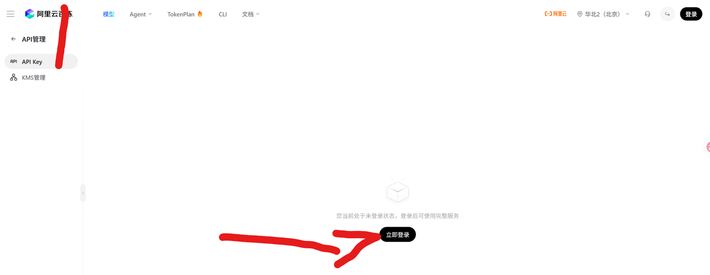
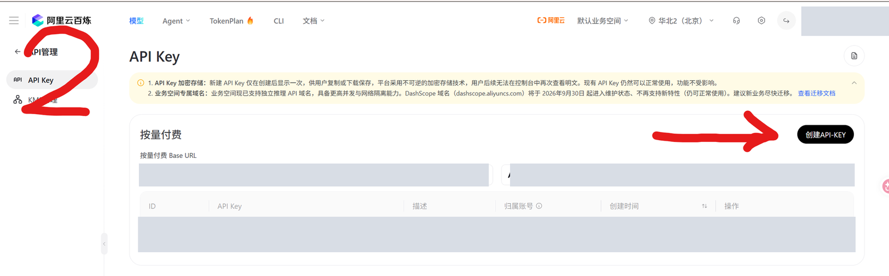
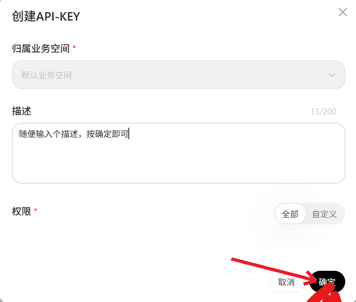
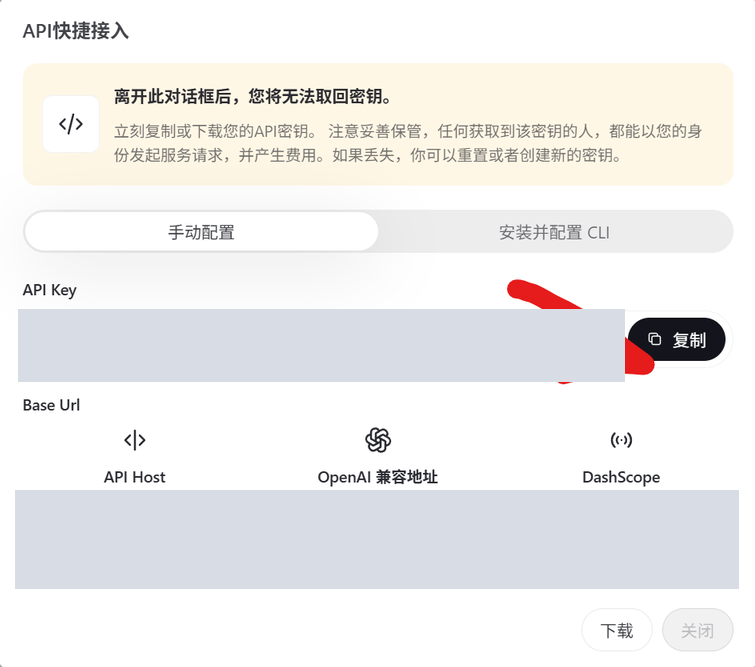
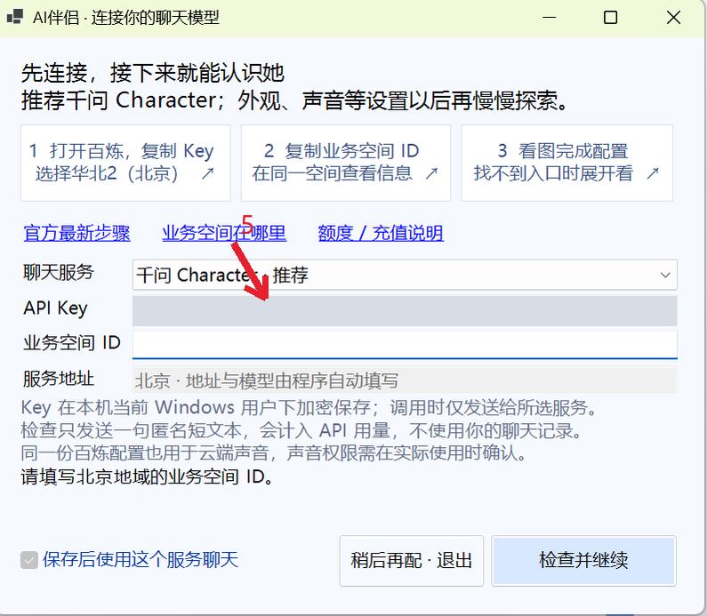
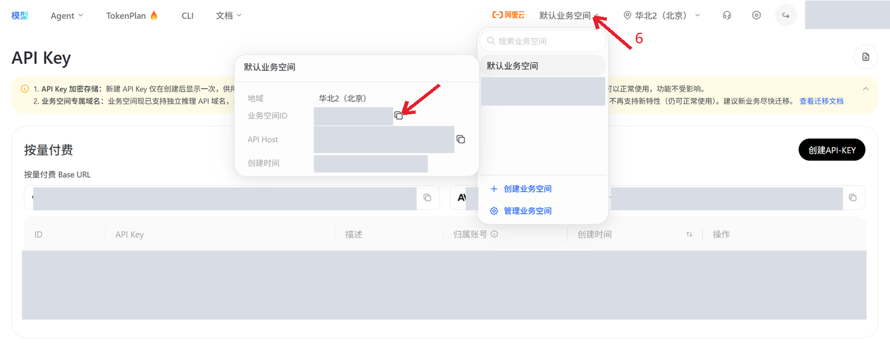
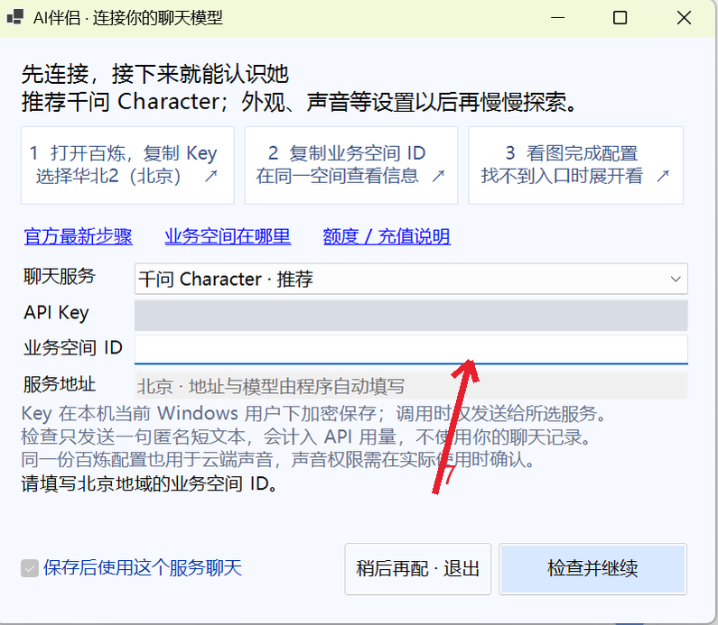
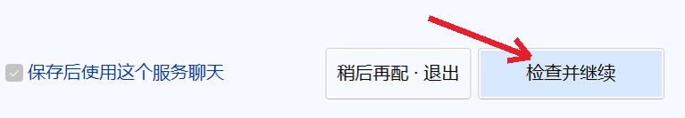

# Qwen Character の接続：8 ステップ

[API Key](https://bailian.console.aliyun.com/cn-beijing/model/settings/api-key) · [Official guide](https://help.aliyun.com/zh/model-studio/get-api-key) · [Workspace ID](https://help.aliyun.com/zh/model-studio/obtain-the-app-id-and-workspace-id)

## 1. 北京の Bailian API Key ページを開いてログインします。

## 2. 创建 API Key をクリックします。既定のワークスペースを利用できます。

## 3. 説明を入力し、Qwen Character の権限を確認して確定します。

## 4. API キーの横の 复制（コピー）をクリックします。

## 5. AI Companion に戻り API Key 欄に貼り付けます。

## 6. Bailian に戻って上部のワークスペースを開き、业务空间 ID をコピーします。

## 7. AI Companion の Workspace ID 欄に貼り付けます。

## 8. 检查并继续（確認して続行）をクリックし、リソースの準備を終えて開始します。

API usage is billed by your provider. Do not share your key or post it in screenshots. The default workspace is supported; use the actual ID from the same workspace as your key.
