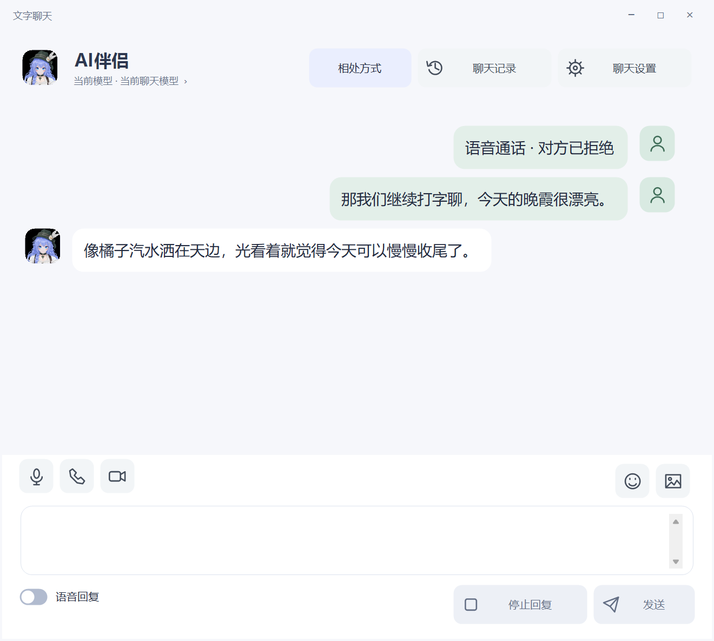
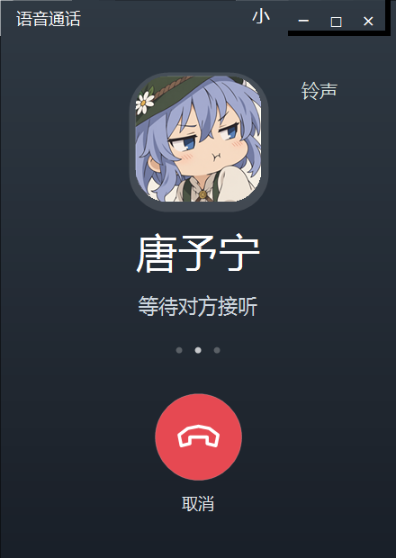
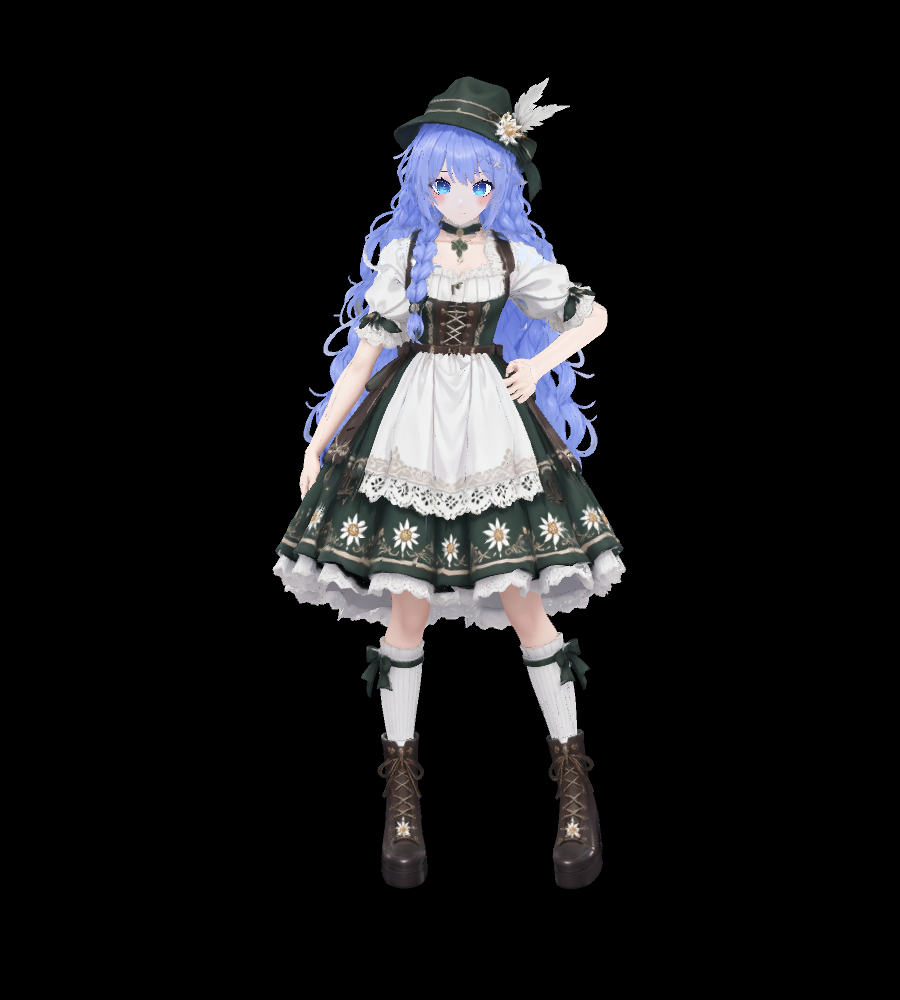
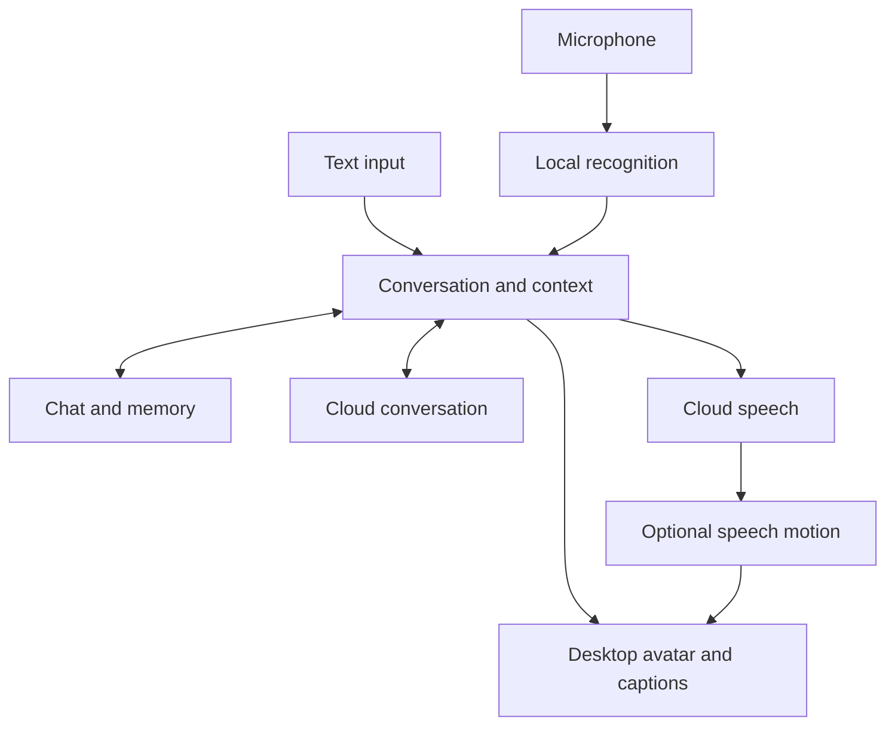

<h1 align="center">AI Companion</h1>

<strong>A little company, right on your desktop.</strong>

<a href="../../README.md">简体中文</a> · <a href="../../docs/i18n/README.zh-TW.md">繁體中文</a> · <a href="../../docs/i18n/README.en.md">English</a> · <a href="../../docs/i18n/README.ja.md">日本語</a>

   

 <a href="../../docs/SETUP.en.md">Illustrated setup guide</a> · <a href="https://github.com/ycwdjb599-hub/ai-companion-desktop/releases/latest">Releases</a> · <a href="https://github.com/ycwdjb599-hub/ai-companion-desktop/issues/new/choose">Report a problem</a>

<a href="#companion">Meet your companion</a> · <a href="#technology">Technology</a> · <a href="#start">Quick start</a> · <a href="#requirements">Requirements</a>

A companion that lives on your Windows desktop. Talk about your day through text or voice, with chat history and memory stored on your own computer.

## 0.1.17 · Alpine 16 speech motion and call fixes

- **Speech motion for Alpine 16**: rebinds the current skeleton and palms, preserves seated legs, smooths sudden changes and blends back from the actual pose.
- **A response after refusal**: voice and video wait for a variable ringing period. Local relationship refusals leave a short, silent text explanation. Fixed the white background on upper-right call controls.

- **Text, stickers and images**: consistent outline controls; sending clears the composer immediately. Completed replies appear together. Change either avatar and adjust text size in chat settings.
- **A dedicated call screen**: avatar, ringing, duration and hang-up controls. Acceptance and refusal have variable waiting times; cancellation cannot become a late connection. Push-to-talk remains available.
- **Quiet proactive messages**: opt in through settings. These messages are never read aloud. With no reply, at most one optional follow-up is allowed before sharing pauses.
- **Get acquainted first**: a new companion does not immediately accept calls. Contact willingness uses actual interaction and the current relationship, without a visible affection score. Text chat remains available after refusal.
- **Continue where you left off**: the confirmed first-run mode survives restarts. Later changes live in Settings → Interaction & shortcuts → Relationship mode → App mode.

Selected images are sent to the configured vision service for interpretation. The main chat model does not need to change.

The base resource version is unchanged; verified existing resources are reused. See [release history](../CHANGELOG.md) for changes and validation scope.

<table><tr><td width="72%"></td><td width="28%"></td></tr></table>

Actual Windows UI. Chat text is a test fixture, not a private user conversation.

The default is **Alpine 16 Daisy**, with Model 2 retained for fallback. Optional audio-driven motion now supports this exact Alpine 16 build; basic chat works independently. Cold model loading took about 46 seconds on the test PC, with the worker reused afterward; other devices may differ. Actual audio playback, standing/seated motion and refusal flows were checked. Full human-microphone calls and video media were not revalidated.

## Company that stays on your desktop

<table>
<tr>
<td align="center" width="36%"> Alpine 16 · Runtime avatar portrait</td>
<td width="64%">

<strong>Desktop presence</strong> Dragging, taskbar and window-edge sitting, idle animations and expressions.

<strong>Text and voice</strong> Text chat, push-to-talk and continuous listening; interrupt a reply with a button.

<strong>Local continuity</strong> Chat history and memory on your PC, with a history viewer to revisit conversations.

<strong>Your preferences</strong> Draggable captions, scrolling or sentence mode, fonts, colors, size, FPS and rendering quality.

</td>
</tr>
</table>

## Built with

Cloud services handle conversation and speech synthesis; your PC handles recognition, avatar presentation and data storage. Motion is prepared separately, so a failed motion download does not block basic chat.

| Module | Current technology | Role |
| --- | --- | --- |
| Desktop Host | **C# · .NET 10 · WinForms** | Windows interface and conversation orchestration |
| Avatar | **Unity · UniVRM** | Transparent desktop avatar, VRM, expressions and animation |
| Conversation | **Qwen Character · OpenAI-compatible API** | Recommended conversation service using your own API key |
| Speech recognition | **SenseVoiceSmall INT8 · sherpa-onnx · Silero VAD** | Local speech recognition and voice activity detection |
| Speech synthesis | **Qwen TTS API** | Cloud speech synthesis; local voice models are optional |
| Memory | **SQLite · Qwen3 Embedding 0.6B** | Chat/state storage and local semantic history retrieval |
| Speech motion | **StreamTalk · WavLM · Fixed Body → Alpine 16** | Optional audio-driven motion and avatar rig adaptation |
| Distribution | **Velopack · GitHub Releases · SHA-256** | Installation, resumable resources, integrity checks and version distribution |

How input, conversation, memory and motion connect

## Three steps to your first conversation

1. **Install** — Download and run the Windows installer above. No manual Unity Editor, Python or Conda setup is required.
2. **Connect** — Choose a resource drive and click 准备并继续 (Prepare and continue). Resources download automatically. Follow the illustrated guide to enter your Qwen Character key and Workspace ID, then click 检查并继续 (Check and continue).
3. **Start** — Click 开始陪伴 (Start). Right-click the character for settings; explore appearance and voice options whenever you like.

[Illustrated setup guide](../../docs/SETUP.en.md)

| Action | Default |
| --- | --- |
| Open settings | Right-click the character |
| Push-to-talk | Right Ctrl |
| Toggle continuous voice | Ctrl + Alt + V |
| Stop playback | Esc |

Shortcuts can be changed in settings.

## Before you start

| Item | Requirement |
| --- | --- |
| System | Windows 10 / 11, x64. The app UI is currently Simplified Chinese. |
| Connection | Your own API key and access to GitHub and your selected provider. The app is free; API usage is billed by the provider. |
| Storage | About 2.1 GiB for base resources, plus approximately 4.7 GiB for full speech motion. Keep 25 GB free for the full setup. |
| Local motion | NVIDIA GPU and 16–32 GB RAM recommended. 8 GB VRAM is a validation target, not a guaranteed minimum. |

## Downloads, updates and privacy

Can I start if motion preparation fails?

Once core chat, memory and your API are ready, choose 先开始使用 · 动作稍后补齐 (Start now; finish motion later). Idle and speech motion are prepared independently and can be completed later.

How do I update an existing installation?

Exit the old version and run the new installer, retaining the same data and resource locations. Releases is the online version source. The app supports local update packages; GitHub automatic updates are not connected yet.

Where are my chats and keys stored?

Chat and memory stay local. Keys use Windows DPAPI encryption for the current user. Cloud APIs receive the text and context needed to provide the requested service.

What if Windows blocks the installer?

The preview installer has no commercial code-signing certificate. Check this repository’s Releases and SHA256SUMS.txt; do not disable system protection.

[Install, update and uninstall](../../docs/INSTALL.md) · [Privacy](../../docs/PRIVACY.md) · [Third-party notices](../../docs/THIRD_PARTY.md)

---

This is the public download, documentation and feedback repository. Development source remains private.

Presentation references：[Project AIRI](https://github.com/moeru-ai/airi) · [Open-LLM-VTuber](https://github.com/Open-LLM-VTuber/Open-LLM-VTuber) · [Mate Engine](https://github.com/shinyflvre/Mate-Engine)。
