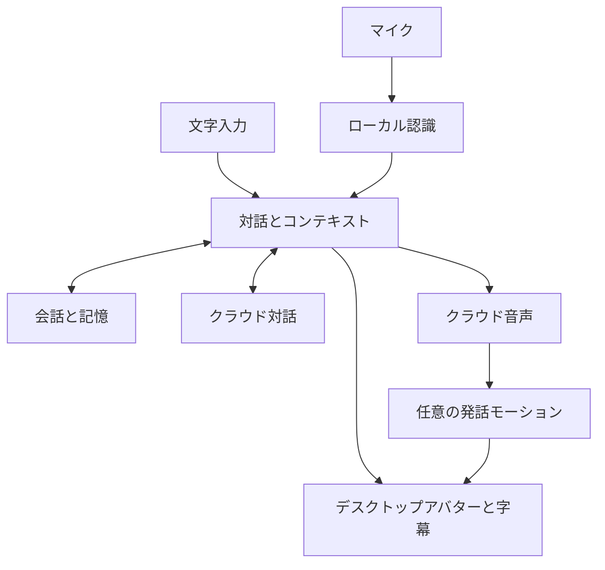

<h1 align="center">AI Companion</h1>

<strong>デスクトップに、話し相手を。</strong>

<a href="../../README.md">简体中文</a> · <a href="../../docs/i18n/README.zh-TW.md">繁體中文</a> · <a href="../../docs/i18n/README.en.md">English</a> · <a href="../../docs/i18n/README.ja.md">日本語</a>

   

 <a href="../../docs/SETUP.ja.md">画像付き設定ガイド</a> · <a href="https://github.com/ycwdjb599-hub/ai-companion-desktop/releases/latest">リリース</a> · <a href="https://github.com/ycwdjb599-hub/ai-companion-desktop/issues/new/choose">問題を報告</a>

<a href="#companion">キャラクターと機能</a> · <a href="#technology">技術</a> · <a href="#start">クイックスタート</a> · <a href="#requirements">利用環境</a>

Windows のデスクトップに暮らす AI の話し相手。文字や声で今日のことを話せます。会話履歴と記憶は自分の PC に保存されます。

## デスクトップで、そばにいる

<table>
<tr>
<td align="center" width="36%"> Model 2 · 現在の既定アバター</td>
<td width="64%">

<strong>デスクトップの存在感</strong> ドラッグ、タスクバーやウィンドウ端の座り姿勢、待機モーションと表情。

<strong>文字と音声</strong> 文字チャット、押して話す、連続音声。ボタンで応答を中断できます。

<strong>会話の続き</strong> 履歴と記憶を PC に保存。履歴ビューアーで会話を振り返れます。

<strong>自分好みの表示</strong> 移動できる字幕、スクロール・文単位表示。フォント、色、サイズ、FPS、画質を調整。

</td>
</tr>
</table>

## 使っている技術

対話と音声合成はクラウド、認識・アバター表示・データ保存は PC で処理します。モーションは独立して準備するため、ダウンロード失敗でも基本チャットを先に利用できます。

| モジュール | 現在の技術 | 役割 |
| --- | --- | --- |
| デスクトップ UI | **C# · .NET 10 · WinForms** | Windows UI と会話処理の統括 |
| アバター表示 | **Unity · UniVRM** | 透明デスクトップアバター、VRM、表情とアニメーション |
| AI 対話 | **Qwen Character API** | 自分の API キーを使う推奨対話サービス |
| 音声認識 | **SenseVoiceSmall INT8 · sherpa-onnx · Silero VAD** | ローカル音声認識と発話検出 |
| 音声合成 | **Qwen TTS API** | クラウド音声合成。ローカル音声モデルは任意 |
| ローカル記憶 | **SQLite · Qwen3 Embedding 0.6B** | 会話・状態の保存とローカル履歴の意味検索 |
| 発話モーション | **StreamTalk · WavLM · Fixed Body** | 任意の音声駆動モーションとアバター骨格への適用 |
| インストール・配布 | **Velopack · GitHub Releases · SHA-256** | インストール、リソース再開、整合性確認とバージョン配布 |

入力・対話・記憶・モーションのつながり

## 3 ステップで最初の会話へ

1. **インストール** — 上の Windows インストーラーを実行します。Unity Editor、Python、Conda を手動で導入する必要はありません。
2. **接続** — 保存先を選び 准备并继续（準備して続行）をクリック。リソースは自動取得されます。画像ガイドに沿って Qwen Character キーと Workspace ID を入力し、检查并继续（確認して続行）をクリックします。
3. **開始** — 开始陪伴（開始）をクリック。右クリックで設定を開けます。外観や音声の設定は後からゆっくり調整できます。

[画像付き設定ガイド](../../docs/SETUP.ja.md)

| 操作 | 既定 |
| --- | --- |
| 設定を開く | アバターを右クリック |
| 押して話す | Right Ctrl |
| 連続音声を切り替え | Ctrl + Alt + V |
| 再生を停止 | Esc |

ショートカットは設定で変更できます。

## 利用前に

| 項目 | 説明 |
| --- | --- |
| システム | Windows 10 / 11、x64。アプリ UI は現在、簡体字中国語です。 |
| 接続 | 自分の API キーと GitHub・利用サービスへの接続。アプリは無料、API 料金は提供元が請求します。 |
| 空き容量 | 基本リソースは約 2.1 GiB、完全な発話モーションはさらに約 4.7 GiB。完全な準備には 25 GB の空き容量を推奨。 |
| ローカルモーション | NVIDIA GPU、16–32 GB RAM を推奨。VRAM 8 GB は検証中の目標で、保証済み最低要件ではありません。 |

## ダウンロード・更新・プライバシー

モーションの準備に失敗しても開始できますか？

基本チャット、記憶、API の準備後、先开始使用 · 动作稍后补齐（先に使う）を選べます。待機と発話モーションは独立して準備され、後から追加できます。

既存のインストールを更新するには？

旧版を終了し、同じデータとリソース保存先を保って新インストーラーを実行します。オンライン版は Releases を確認。アプリはローカル更新パッケージに対応し、GitHub 自動更新はまだ接続していません。

会話とキーはどこに保存されますか？

会話と記憶は PC に保存。キーは現在の Windows ユーザー向けに DPAPI で暗号化されます。クラウド API にはサービスに必要な文章とコンテキストが送られます。

Windows にインストーラーをブロックされたら？

商用コード署名はまだありません。このリポジトリの Releases と SHA256SUMS.txt を確認し、システム保護を無効にしないでください。

[インストール・更新・アンインストール](../../docs/INSTALL.md) · [プライバシー](../../docs/PRIVACY.md) · [第三者ライセンス](../../docs/THIRD_PARTY.md)

---

公開ダウンロード・文書・フィードバック用のリポジトリです。開発ソースは非公開です。

構成の参考：[Project AIRI](https://github.com/moeru-ai/airi) · [Open-LLM-VTuber](https://github.com/Open-LLM-VTuber/Open-LLM-VTuber) · [Mate Engine](https://github.com/shinyflvre/Mate-Engine)。
