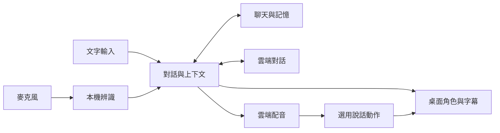

<h1 align="center">AI伴侶</h1>

<strong>桌面上，多一個陪你說話的人。</strong>

<a href="../../README.md">简体中文</a> · <a href="../../docs/i18n/README.zh-TW.md">繁體中文</a> · <a href="../../docs/i18n/README.en.md">English</a> · <a href="../../docs/i18n/README.ja.md">日本語</a>

   

 <a href="../../docs/SETUP.zh-TW.md">圖文設定教學</a> · <a href="https://github.com/ycwdjb599-hub/ai-companion-desktop/releases/latest">版本與更新</a> · <a href="https://github.com/ycwdjb599-hub/ai-companion-desktop/issues/new/choose">回報問題</a>

<a href="#companion">角色與功能</a> · <a href="#technology">技術棧</a> · <a href="#start">快速開始</a> · <a href="#requirements">使用需求</a>

一個住在 Windows 桌面上的 AI 夥伴。陪你聊聊今天、聽你說話，聊天紀錄與記憶留在你的電腦裡。

## 讓陪伴留在桌面上

<table>
<tr>
<td align="center" width="36%"> Model 2 · 目前預設角色</td>
<td width="64%">

<strong>桌面陪伴</strong> 拖曳、工作列與視窗邊緣坐姿，待機動作與表情。

<strong>文字與語音</strong> 文字聊天、按住說話、連續語音；可用按鈕中斷回覆。

<strong>交流有延續</strong> 在本機保存聊天紀錄與記憶，可以隨時開啟歷史紀錄。

<strong>依習慣調整</strong> 可拖曳字幕、逐句或捲動顯示；調整字型、顏色、大小、幀率和畫質。

</td>
</tr>
</table>

## 背後的技術

雲端提供對話與配音，本機處理辨識、角色呈現與資料保存。動作模組獨立準備，下載失敗時仍可先用基本聊天。

| 模組 | 目前技術 | 用途 |
| --- | --- | --- |
| Desktop Host | **C# · .NET 10 · WinForms** | Windows 介面與會話編排 |
| Avatar | **Unity · UniVRM** | 透明桌面角色、VRM、表情與動畫 |
| Conversation | **Qwen Character API** | 推薦的對話服務；使用自己的 API Key |
| Speech recognition | **SenseVoiceSmall INT8 · sherpa-onnx · Silero VAD** | 本機語音辨識與說話偵測 |
| Speech synthesis | **Qwen TTS API** | 雲端配音；本機聲音模型為選用項目 |
| Memory | **SQLite · Qwen3 Embedding 0.6B** | 聊天與狀態保存、本機歷史語義檢索 |
| Speech motion | **StreamTalk · WavLM · Fixed Body** | 選用的語音驅動動作與角色骨架適配 |
| Distribution | **Velopack · GitHub Releases · SHA-256** | 安裝、資源續傳、完整性檢查與版本分發 |

查看輸入、對話、記憶與動作如何連接

## 三步，開始第一次聊天

1. **安裝** — 下載並執行上方 Windows 安裝程式，不必手動安裝 Unity 編輯器、Python 或 Conda。
2. **連線** — 首次開啟選擇資源磁碟，點「准备并继续」；資源自動下載。依圖文教學填入千問 Character Key 與業務空間 ID，再點「检查并继续」。
3. **開始陪伴** — 準備完成後點「开始陪伴」。右鍵角色開啟設定，其餘外觀與聲音選項可以之後再調整。

[圖文設定教學](../../docs/SETUP.zh-TW.md)

| 操作 | 預設方式 |
| --- | --- |
| 開啟設定 | 右鍵角色 |
| 按住說話 | Right Ctrl |
| 連續語音開關 | Ctrl + Alt + V |
| 停止播放 | Esc |

快捷鍵可以在設定中修改。

## 開始前需要什麼

| 項目 | 說明 |
| --- | --- |
| 系統 | Windows 10 / 11，64 位；軟體介面目前為簡體中文。 |
| 連線 | 自備 API Key，可存取 GitHub 與所選服務；軟體免費，API 由服務提供者計費。 |
| 資源空間 | 初次基本下載約 2.1 GiB；完整說話動作另需約 4.7 GiB。完整準備建議資源磁碟保留 25 GB。 |
| 本機動作 | 建議 NVIDIA 顯示卡、16–32 GB 記憶體；8 GB VRAM 是待繼續驗證的目標，尚非已保證的最低需求。 |

## 下載、更新與隱私

動作下載失敗還能使用嗎？

基本聊天、記憶與 API 就緒後，可點「先开始使用 · 动作稍后补齐」。待機與說話動作獨立準備，之後可在動作資源頁補齊。

已經安裝，要如何更新？

退出舊版後執行新版安裝程式，保留相同資料與資源位置。線上版本以 Releases 為準；應用目前支援本機更新包，尚未接入 GitHub 自動更新。

聊天與 Key 保存在哪裡？

聊天與記憶保存在本機。Key 透過 Windows DPAPI 依目前使用者加密；雲端 API 會收到所需文字及相關上下文。

Windows 攔截安裝程式？

安裝包尚無商業程式碼簽章。請確認本倉庫 Releases 來源與 SHA256SUMS.txt，不必關閉系統防護。

[安裝、升級與解除安裝](../../docs/INSTALL.md) · [隱私說明](../../docs/PRIVACY.md) · [第三方授權與署名](../../docs/THIRD_PARTY.md)

---

此處是公開下載、文件與回報入口；研發原始碼倉庫維持非公開。

設計參考：[Project AIRI](https://github.com/moeru-ai/airi) · [Open-LLM-VTuber](https://github.com/Open-LLM-VTuber/Open-LLM-VTuber) · [Mate Engine](https://github.com/shinyflvre/Mate-Engine)。
